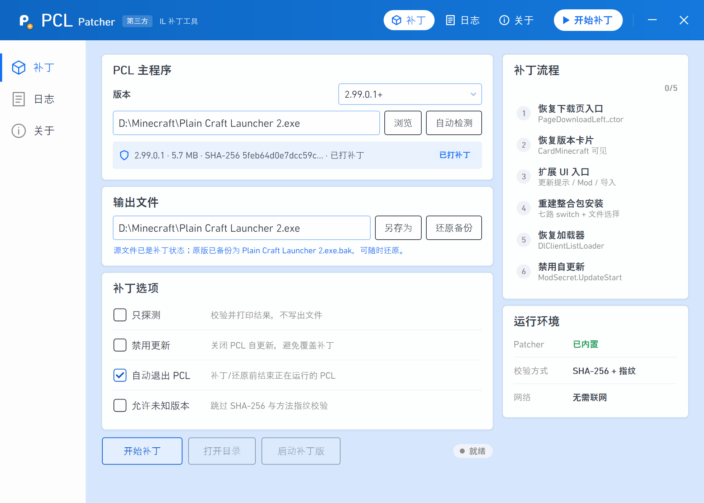

<p align="center">
  
</p>

# PCL Patcher

> 本项目仅用于个人学习、研究与技术验证，不得用于任何商业或违法用途；使用前请
> 确认你的行为以及本项目涉及的功能修改符合当地法律法规。
> 下载或体验后请于 24 小时内删除。

> **合规提示**
>
> 本项目**不提供、不支持、不授权**以下行为：游戏下载与代下载、账号交易与共享、私服或
> 运营服务、绕过实名制/防沉迷/版号审批/区域限制/付费、商业倒卖，以及冒充官方或
> 暗示与 PCL 作者存在关联。补丁后的 PCL 属于修改版，**分发行为受到许可证限制**。完整说明见下方
> [「合规与法律风险」](#合规与法律风险)与 [DISCLAIMER.md](DISCLAIMER.md)。

> **侵权联系删除**
>
> 如你认为本仓库中的代码、文档、图标或发布物侵犯了你的合法权益，请通过
> [Issues](https://github.com/Xtopia5616/PCL-Patcher/issues) 联系，核实后会在合理时间内删除或调整相关内容。

Plain Craft Launcher (PCL) 的第三方 IL 补丁工具：恢复被移除的下载入口、修掉资源列表的加载、替换修复联机功能。

许可证：[MIT](LICENSE)（原创部分；PCL 派生文件除外，遵守其原有许可证） · 免责声明：[DISCLAIMER.md](DISCLAIMER.md) ·
第三方说明：[NOTICE.md](NOTICE.md)

## 项目定位与范围声明

**功能：解锁 PCL 的下载入口以及联机入口。**

- **下载**：恢复“原版游戏”、整合包导入、资源详情安装等被移除的下载入口。
- **联机**：仅在选择“同时解锁联机”时处理，恢复联机页签与设置项；补丁不内置任何节点。
- **不涉及赞助内容**：本项目**不会**解锁、破解、绕过或伪造任何赞助（捐赠 / 爱发电）
  相关内容与权益，不提供赞助者身份、赞助码、赞助专属功能或付费能力。PCL 的赞助与
  作者权益请通过官方渠道支持：<https://meloong.com/afd/a/LTCat>。
- 本项目与 PCL 作者龙腾猫跃、成都瓜皮龙科技有限公司、网易、Microsoft、Mojang
  **没有**隶属、合作、赞助或授权关系。

> 只需要下载功能时，请取消勾选“同时解锁联机”；这样补丁不会写入联机相关逻辑。

<p align="center">
  
</p>
<p align="center">
  <sub>主界面：选择 PCL 主程序 → 校验版本与指纹 → 逐步应用补丁 → 随时还原 <code>.bak</code> 备份</sub>
</p>

## 合规与法律风险

**使用本项目
前，请确认你的行为以及本项目涉及的功能修改符合当地法律法规；如不确定，请不要使用。**

### 1. 游戏出版、进口与运营

- 在中国大陆，网络游戏的出版、进口与运营通常需要取得网络出版服务许可、游戏版号/
  审批，并遵守内容审核、实名制与未成年人保护等要求，主要见于《网络出版服务管理
  规定》《互联网文化管理暂行规定》及国家新闻出版署的配套规定。
- Minecraft 在中国大陆由**网易**独家运营（《我的世界》中国版，<https://mc.163.com/>）；
  国际版并未在中国大陆取得同等的官方运营与发行安排。
- 本项目不提供、也不应被用于向公众提供游戏下载、代下载、账号共享、区域绕过、私服
  搭建或运营服务；把恢复后的入口用于上述目的，可能涉及游戏进口、出版、运营资质与
  独家授权等合规问题。

### 2. 技术措施与著作权

- PCL 作者关闭部分下载入口，是应合规要求做出的功能调整。本项目只在本机副本上验证
  IL 重建这一技术问题，不提供规避方法、工具或抗辩。
- 修改后的 PCL 不再是原作者发布的版本，其复制、传播与使用受 PCL 许可及著作权法约束。

### 3. 实名制、防沉迷与未成年人保护

- 本项目不提供账号、登录、支付能力，也不提供绕过实名认证、防沉迷或未成年人保护的
  任何功能；不得被用于此类目的。
- 未成年人使用游戏服务应遵守《未成年人保护法》及国家新闻出版署关于防沉迷的规定，
  监护人应尽到监护责任。

### 4. 网络安全、数据与个人信息

- 本项目不收集遥测，不主动上传文件；但补丁后的 PCL 仍会按其自身逻辑联网，相关数据
  处理以其隐私政策为准。
- 不得利用本项目侵入、干扰、破坏计算机信息系统，或非法获取、出售、提供个人信息，
  否则可能违反《网络安全法》《数据安全法》《个人信息保护法》等规定。

### 5. 平台、账号与安全风险

- 修改客户端的行为可能触发安全软件报毒。
- 请只从官方渠道获取 PCL 与 Minecraft，不要使用来源不明的二次分发版本。

### 6. PCL 与 Minecraft 的许可

- 本项目对 PCL 的使用按[《存储库合理使用指南》](https://github.com/Meloong-Git/PCL/blob/main/LICENCE)
  处理：标注第三方、保留署名与赞助链接、公开源代码、保持蓝色主色。
- 本项目**不授予**任何 PCL、Minecraft 或第三方软件的权利；`PclTheme.xaml` 等 PCL
  派生内容不适用 MIT，详见 [NOTICE.md](NOTICE.md)。
- Minecraft 的下载、安装与游玩受 [Minecraft EULA](https://www.minecraft.net/eula) 约束；
  请购买支持正版：<https://www.minecraft.net/>。

### 7. 责任自担

在适用法律允许的最大范围内，本项目按“现状”提供，不附带任何担保；因使用本项目产生
的数据丢失、文件损坏、账号处罚、第三方索赔及法律与合规责任，由使用者自行承担。
完整条款见 [LICENSE](LICENSE) 与 [DISCLAIMER.md](DISCLAIMER.md)。

## 使用边界

> 本工具只在本机合法持有的 PCL 副本上做技术验证：默认原地替换并自动生成 `.bak`，
> 可随时还原；不修改 PCL 官方发布，也不分发修改版。补丁后的 PCL 属于 PCL 的
> 修改版，请勿再分发。

## 下载

预编译产物见 [Releases](https://github.com/Xtopia5616/PCL-Patcher/releases)：

| 文件 | 说明 |
|---|---|
| `PclPatcher.Gui.Net48.exe` | 单文件 GUI（.NET Framework 4.8），内嵌补丁器，双击即用 |
| `PclPatcher.exe` | 自包含命令行补丁器（win-x64 single-file），无需预装 .NET |

GUI 运行需要本机已安装 PCL。仓库源码本身不包含 PCL 本体，构建说明见下文。

## 目录结构

```text
patcher-lab/
├─ src/
│  ├─ PclPatcher/                   命令行补丁器（net10.0）
│  │  ├─ Program.cs                 入口、参数解析、主流程
│  │  ├─ Profiles.cs                已知版本、SHA-256、渠道与方法指纹
│  │  ├─ BuildIdentity.cs           渠道识别、结构指纹匹配、--identify / --adopt
│  │  ├─ Probes.cs                  PatchPlan 能力探测（不改模块）
│  │  ├─ Patches.Download.cs        下载页与 UI 入口补丁
│  │  ├─ Patches.Modpack.cs         整合包安装、加载器、自更新
│  │  ├─ Patches.CurseForge.cs      CurseForge API 镜像
│  │  ├─ Patches.Link.cs            联机入口、开关与节点检查
│  │  ├─ Patches.LinkNotice.cs      联机页示例文本替换
│  │  ├─ FileOperations.cs          备份、还原、原子替换、结束 PCL
│  │  └─ IlHelpers.cs               IL 校验、指纹与通用工具
│  └─ PclPatcher.Gui.Net48/         单文件 GUI（net48 WPF）
│     ├─ App.xaml(.cs)              启动、PCL 程序集 / 字体 / 主题加载
│     ├─ MainWindow.cs              窗口字段与构造函数
│     ├─ Views/                     补丁页、日志页、关于页等分页代码
│     ├─ Controls/                  PCL 风格控件封装、日志面板、自绘对话框、PCL 查找窗口
│     ├─ Common/                    版本目录（`--profiles`）、PCL 定位、快捷方式解析、本地设置
│     └─ Properties/AssemblyInfo.cs
├─ assets/icon/                     图标源文件、生成脚本
├─ assets/screenshot/               界面 / 流程截图与截取脚本
├─ build.ps1                        一键构建
├─ PclPatcher.sln                   解决方案（两个项目）
├─ Directory.Build.props            项目公共元数据
├─ Directory.Packages.props         中央包版本
├─ PCL-PATCHER.md                   补丁原理、IL 细节与实测记录
├─ LICENSE / DISCLAIMER.md / NOTICE.md / THIRD-PARTY-NOTICES.md
└─ dist/                            构建产物（已 gitignore）
```

GUI 的 `Assets` 不单独存图：图标统一来自 `assets/icon/`，通过链接资源打包。

## 环境要求

| 用途 | 要求 |
|---|---|
| 构建 | Windows 10/11 x64、.NET SDK 10.0.400+（`global.json` 固定 10.0.403） |
| GUI 编译 | 本机安装 PCL，默认 `D:\Minecraft\Plain Craft Launcher 2.exe` |
| GUI 运行 | .NET Framework 4.8（Windows 10/11 自带） |
| 补丁目标 | PCL 2.99.0.0+（正式版与快照版，见 `Profiles.cs` 与 [VERSIONS.md](VERSIONS.md)） |

PCL 只在编译期提供 `Plain Craft Launcher 2` 程序集引用，以及运行期加载控件 /
字体；**不会**被打进发布包。

## 构建

```powershell
pwsh .\build.ps1

# PCL 不在默认路径时
pwsh .\build.ps1 -PclLauncherPath "D:\Games\Plain Craft Launcher 2.exe"
```

产物：

| 文件 | 说明 |
|---|---|
| `dist/PclPatcher.exe` | 约 36 MB，自包含单文件，完整补丁工具 |
| `dist/PclPatcher.Gui.Net48.exe` | 约 38 MB，单文件 GUI，内嵌 patcher 与主题 |

GUI 编译时需要 `dist/PclPatcher.exe` 作为内嵌 payload。`build.ps1` 会先发布
patcher；直接 `dotnet build` GUI 项目时，csproj 也会自动补一次 publish。

也可以单独构建：

```powershell
dotnet build .\src\PclPatcher\PclPatcher.csproj -c Release
dotnet build .\src\PclPatcher.Gui.Net48\PclPatcher.Gui.Net48.csproj -c Release
```

## 使用

GUI：

0. 首次启动会先弹出「免责声明与使用风险提示」：勾选“我已阅读并理解上述风险”，再点
   “我已知情”才能进入主界面；点“不同意，退出”或关闭窗口会直接退出。确认状态按条款
   版本记录，条款更新后会再次提示；之后可在“关于”页重新查看；
1. 确认 PCL 主程序。不确定就点“自动检测”，它按代价从低到高检查：上次使用的路径 →
   桌面 / 开始菜单快捷方式 → 注册表（App Paths、卸载项、最近运行记录）→
   常见目录浅层扫描（固定盘根、Program Files、桌面 / 下载 / 文档）；
2. 如果都没找到，查找窗口会保持打开并持续观察进程：此时启动一次 PCL，就会直接从
   运行中的进程反查它的 exe 路径，无需全盘扫描；
3. 输出文件默认就是源文件（原地补丁）；
4. 在“补丁选项”里选择解锁范围：“同时解锁联机”**默认勾选**（下载 + 联机）；
   取消勾选则**只解锁下载**。“禁用更新”**默认勾选**，否则打好的旧版本会在启动时
   被 PCL 自更新换回新版（例如 2.99.0.0 被换成 2.99.0.1）。随后点“开始补丁”，
   先结束正在运行的 PCL，再自动备份为 `.bak` 并原子替换；
5. 随时用“还原备份”恢复原版。

用过的路径会记在 `%LOCALAPPDATA%\PclPatcher\settings.json`（最多 5 条），下次启动
优先复查，通常不需要再点“自动检测”。同一文件也记录已确认的免责声明版本与确认时间；
删除它会让首次使用提示重新出现。

GUI 默认以管理员权限启动（`app.manifest` 的 `requireAdministrator`）：双击时 Windows
会弹一次 UAC，之后补丁 / 还原都不再单独申请权限，也不会因为提权重启而丢掉当前选择。
代价有两点：提权窗口收不到从资源管理器拖入的文件（UIPI 隔离），拖拽请改用“浏览…”；
「启动 PCL」经 `explorer.exe` 代启，PCL 及其拉起的 Java 仍是普通权限。自动化或截图
场景不想被 UAC 挡住时，用 `dotnet build -p:PclPatcherNoElevation=true` 构建普通权限版本。

命令行：

```powershell
# 原地补丁，生成 PCL.exe.bak
.\dist\PclPatcher.exe "D:\Minecraft\Plain Craft Launcher 2.exe"

# 另存为副本，源文件不变
.\dist\PclPatcher.exe "D:\Minecraft\Plain Craft Launcher 2.exe" ".\PCL-patched.exe"

# 只解锁下载，跳过联机相关补丁
.\dist\PclPatcher.exe "D:\Minecraft\Plain Craft Launcher 2.exe" --download-only

# 只探测，不写文件
.\dist\PclPatcher.exe "D:\Minecraft\Plain Craft Launcher 2.exe" --dry-run

# 还原
.\dist\PclPatcher.exe "D:\Minecraft\Plain Craft Launcher 2.exe" --restore
```

| 参数 | 作用 |
|---|---|
| `--dry-run` | 应用并校验，但不写文件 |
| `--restore` | 从 `<源文件>.bak` 还原 |
| `--force` | 绕过未知哈希 / 指纹校验 |
| `--allow-partial` | 缺失 required 步骤时继续（仅用于新版本探测） |
| `--download-only` | 只解锁下载，跳过七个联机补丁步骤 |
| `--no-update` | 把 `ModSecret.UpdateStart` 改成 `ret`，禁用自更新 |
| `--no-stop` | 不自动结束正在运行的 PCL |
| `--fingerprints` | 打印关键方法指纹 |
| `--identify` | 机器可读的构建身份（`exact` / `structural` / `unknown`，GUI 使用） |
| `--adopt` | 打印新构建的渠道、哈希、指纹、Probe 矩阵与可粘贴的 profile 条目 |
| `--adopt --save` | 同上，并写入 `%LOCALAPPDATA%\PclPatcher\profiles.tsv`（可用 `PCLPATCHER_PROFILES` 改路径） |
| `--profiles` | 输出机器可读的受支持版本列表（GUI 使用，无需源文件） |

## 补丁步骤

| 步骤 | 作用 |
|---|---|
| `DownloadLeftCtor` | 恢复“原版游戏”入口与默认子页 |
| `ModifyCard` | 恢复版本修改页的 MC 卡片 |
| `ExtraUiEntries` | 恢复更新提示“下载”、Mod 禁用页、启动页空状态、资源详情安装、导入整合包 |
| `ModpackInstall` | 重建七路 `switch` 与无参入口的文件选择 |
| `LoaderInit` | 重建真实的 `DlClientListLoader` |
| `CurseForgeMirror` | CurseForge API 改走内置 MCIMirror 反代，避免官方源连不上时搜索为空 |
| `RestoreLinkEntry` | 恢复标题栏“联机”页签与设置项（仅联机范围） |
| `LinkIgnoreDisable` | 忽略官方配置里的 `DisableReason2` / `MinVersionCode`（仅联机范围） |
| `LinkRequireCustomPeer` | 未填自定义节点时提示并中止（仅联机范围，不内置默认节点） |
| `LinkPrecheckCustomPeer` | 建房/加入前先检查节点（仅联机范围） |
| `LinkNoticeText` | 把联机页的示例文本换成节点停服/自建说明（仅联机范围） |
| `LinkPeerHint` | 改写“设置 → 联机 → 自定义节点”的悬停说明（仅联机范围） |
| `LinkPeerButtons` | 隐藏“节点状态”按钮，把“贡献节点”按钮换成 EasyTier 官网链接（仅联机范围） |
| `DisableSelfUpdate` | 可选：`--no-update` 时 stub 掉自更新（GUI 默认勾选“禁用更新”） |

`RestoreLinkEntry` 起七个联机步骤只在勾选“同时解锁联机”时执行；命令行加
`--download-only` 等价于取消勾选，只应用下载相关步骤。

选择联机范围时也**默认不带节点**：补丁只恢复入口和解除配置拦截，使用前必须在
**设置 → 联机 → 自定义节点** 里填写一个可用 EasyTier 节点（房主与加入方一致），
详见 [PCL-PATCHER.md](PCL-PATCHER.md) 的「5.1 联机（无默认节点）」。

每一步都有 `Probe`（不修改模块）、`Apply`、`Verify`；写盘前做全模块 IL 校验，
写盘后重新加载再校验。已打补丁的文件再次运行会直接返回 `already`。

<p align="center">
  
</p>
<p align="center">
  <sub>补丁流程面板：左侧序号在运行时依次变成状态图标（进行中 / 完成 / 已跳过 / 失败）</sub>
</p>

## 版本适配

受支持版本表在 `src/PclPatcher/Profiles.cs`：`版本 + 渠道 + SHA-256 + 7 个方法指纹`。
GUI 会通过 `PclPatcher --profiles` 自动跟随，新增版本无需改 UI。

**正式版与快照版分开记**：快照版和正式版共用数字版本号（快照版日志是
`快照版 2.99.0.0`，`FileVersion` 仍是 `2.99.0.0`），所以 profile 多了 `Channel`
字段，渠道由启动器写在程序集里的 `快照版 2.99.0.0` / `正式版 2.99.0.0` 文本识别。

构建身份按三段判定，**后续快照版通常不需要改任何代码**：

| 顺序 | 判据 | 结果 | 需要 `--force` |
|---|---|---|---|
| 1 | SHA-256 命中 profile | 精确匹配 | 否 |
| 2 | 7 个锚点指纹全部命中 | 结构匹配（快照重建走这里） | 否 |
| 3 | 都不命中 | 未知构建 | 是，或先 `--adopt` 收录 |

第 2 段照样跑全部 `Probe`、写盘前后两轮 `Verify` 与全模块 IL 校验，所以“跳过哈希”
不等于“跳过检查”。GUI 对未收录构建会先调 `PclPatcher --identify`，结构匹配时直接
显示“2.99.0.0 快照版（结构匹配）”，不需要勾选“允许未知版本”。

锚点真的移动时，一条命令收录（无需重新编译，GUI 立即生效）：

```powershell
.\dist\PclPatcher.exe "新的 PCL.exe" --adopt          # 打印渠道/哈希/指纹/Probe 矩阵/C# 条目
.\dist\PclPatcher.exe "新的 PCL.exe" --adopt --save   # 写入 %LOCALAPPDATA%\PclPatcher\profiles.tsv
```

更省事的一键流程（识别 → 试运行 → 原地补丁；锚点移动时加 `-Adopt` 先收录）：

```powershell
pwsh .\scripts\adapt_new_pcl.ps1 "新的 PCL.exe" -DryRun   # 只看结论
pwsh .\scripts\adapt_new_pcl.ps1 "新的 PCL.exe"           # 原地补丁（自动 .bak，默认禁用自更新）
pwsh .\scripts\adapt_new_pcl.ps1 "新的 PCL.exe" -Adopt    # 先收录再补丁
```

已归档的官方版本、来源提交、SHA-256、快照版验证结论见 [VERSIONS.md](VERSIONS.md)，
实现细节见 [PCL-PATCHER.md](PCL-PATCHER.md) 的「2.2 快照版与后续版本的自动适配」。

未知且结构也不匹配的版本默认拒绝写入；可先用 `--dry-run` 观察每个步骤的 `Ready /
Already / Missing`，或用 `--force` 强制尝试（仍会逐项 Probe/Verify，但可能产出
不可运行的文件）。

更完整的 IL 分析、控制流重建与实测结论见 [PCL-PATCHER.md](PCL-PATCHER.md)。

## 许可与不分发声明

- 本项目**原创部分**（`src/`、`build.ps1`、文档、图标）采用 [MIT](LICENSE)：
  可商用、可修改、可再分发，保留版权声明与许可文本即可。
- `PclTheme.xaml`、PCL 控件与字体、PCL 本体**不在 MIT 范围内**，权利归
  龙腾猫跃 / PCL 项目，按 [NOTICE.md](NOTICE.md) 的合理使用安排处理；
  第三方许可证全文见 [THIRD-PARTY-NOTICES.md](THIRD-PARTY-NOTICES.md)。
- 用本工具修改 PCL 得到的**补丁产物**仍受 PCL 许可约束，**请勿分发**；
  MIT 只覆盖工具本身，不改变 PCL 的任何权利。
- 完整风险提示见 [DISCLAIMER.md](DISCLAIMER.md)。发布包**不包含**
  `Plain Craft Launcher 2.exe`、PCL 的嵌入 DLL 或 PCL 本体。
