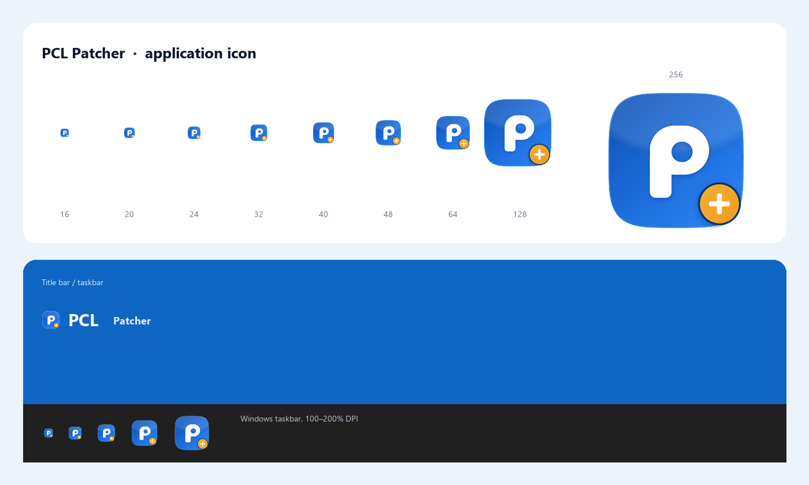

# PCL Patcher 应用图标



## 概念

**蓝色 PCL 方块 + 白色几何 P + 金色“补丁 +”徽章。**

- **蓝色方块**沿用 PCL 的蓝色系和圆角方块语言，但不复制 PCL 的六边形徽标；
- **白色 P** 是 PCL / Patcher 的共同首字母，字形按 PCL English 的圆润几何感重绘，保证 16 px 仍可辨认；
- **右下角的金色加号**是“补上缺的那一块”：PCL Patcher 恢复下载页、版本卡片、整合包安装等被移除的入口。加号徽章同时把“第三方补丁”与 PCL 官方图标区分开；
- 金色 `#FFC24B` 与 PCL 蓝形成高对比，任务栏深色/浅色背景都不会丢。

第三方项目，不使用 PCL 官方图标，也不暗示与 PCL 作者存在隶属关系。

## 颜色

| 用途 | 色值 |
|---|---|
| 方块渐变起 | `#0A4EB3` |
| 方块渐变止 | `#2F8BFF` |
| 字母 / 加号 | `#FFFFFF` |
| 徽章渐变 | `#FFD166` → `#F09A1A` |
| 徽章描边 | `#053170` |
| 阴影 | `#03285B` |

## 文件

| 文件 | 用途 |
|---|---|
| `pcl-patcher-icon.svg` | 矢量母版（1024 × 1024） |
| `pcl-patcher-icon-1024.png` | 透明底位图母版 |
| `pcl-patcher-icon-{512,256,128,64,48,32,24,20,16}.png` | 各尺寸导出 |
| `pcl-patcher.ico` | Windows 多尺寸图标（16–256） |
| `pcl-patcher-mark-512.png` / `-256.png` | 去掉蓝色方块、用于蓝色标题栏的白色 P + 金徽章 |
| `preview.png` | 尺寸与标题栏 / 任务栏预览 |

## 使用

- 图标最小 16 px；小于 32 px 时不建议再加描边、文字或额外装饰；
- 放进界面时，图标外留白至少为图标边长的 1/8（文件本身已带透明边缘）；
- 不改变金色徽章的位置和比例，不把蓝色方块改成其他品牌色；
- 需要单色版本时，用白色 P + 白色加号，不要保留金色渐变。

## 重新生成

```powershell
python .\assets\icon\make_icon.py
```

生成脚本 [`make_icon.py`](make_icon.py) 使用 Pillow 以 4× 超采样绘制，
PNG 缩放采用预乘 alpha 的 Lanczos，避免透明边缘出现黑边；ICO 的 256 px 帧使用 PNG 压缩，
其余尺寸使用 32 bpp DIB + AND mask。
